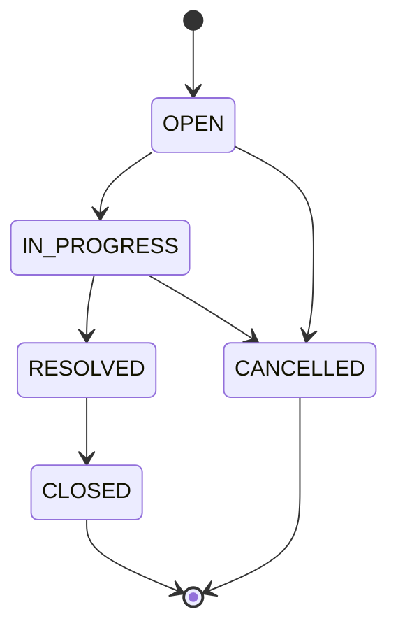

# Ticket status state machine

## Rules

- Initial status on create: `OPEN`.
- Updates to `status` only via `/transition` endpoint (not PATCH).
- Illegal transitions return `409 INVALID_TRANSITION`.

## Test matrix (integration)

| From | To | Expect |
|------|-----|--------|
| OPEN | IN_PROGRESS | 200 |
| IN_PROGRESS | RESOLVED | 200 |
| RESOLVED | CLOSED | 200 |
| OPEN | CANCELLED | 200 |
| IN_PROGRESS | CANCELLED | 200 |
| RESOLVED | OPEN | 409 |
| CLOSED | OPEN | 409 |
| CANCELLED | OPEN | 409 |
| OPEN | CLOSED | 409 |
